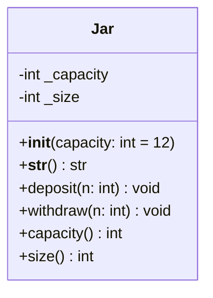

# 🐍 Harvard University: CS50P (Programming with Python)

<div align="center">

[](https://github.com/Sais-gallego/harvard-cs50-python/actions)
[](https://www.python.org/)
[](LICENSE)
[](https://cs50.harvard.edu/python/)
[](https://github.com/Sais-gallego/harvard-cs50-python)

**Implementaciones completas de laboratorios, validaciones avanzadas con expresiones regulares, modelado orientado a objetos (OOP), manejo de excepciones y pruebas unitarias del programa oficial de Harvard University: *CS50's Introduction to Programming with Python*, impartido por el profesor David J. Malan.**

**Autor:** Sergio Andrés Ipuz Saavedra · [@Sais-gallego](https://github.com/Sais-gallego)  
**Institución:** Harvard University (CS50)

---

</div>

## 📑 Tabla de Contenidos

- [Núcleos del Programa CS50P](#-núcleos-del-programa-cs50p)
  - [1. Expresiones Regulares Avanzadas](#1-expresiones-regulares-avanzadas-srccore_programmingpy)
  - [2. Algoritmos Clásicos: Algoritmo de Luhn](#2-algoritmos-clásicos-algoritmo-de-luhn-cs50-credit)
  - [3. Programación Orientada a Objetos (OOP)](#3-programación-orientada-a-objetos---oop-semana-8)
- [📊 Análisis de Complejidad Algorítmica (Big-O)](#-análisis-de-complejidad-algorítmica-big-o)
- [📐 Diagrama de Clases OOP (`Jar`)](#-diagrama-de-clases-oop-jar)
- [🧪 Pruebas Automatizadas (Unittest)](#-pruebas-automatizadas)
- [🚀 Guía de Inicio Rápido](#-guía-de-inicio-rápido)

---

## 🎯 Núcleos del Programa CS50P

### 1. Expresiones Regulares Avanzadas (`src/core_programming.py`)
- **NUMB3RS:** Validación estricta de direcciones IPv4 asegurando el rango $[0, 255]$ por cada octeto mediante grupos de captura regex y validación numérica sin desbordamientos.
- **Watch on YouTube:** Extracción precisa de enlaces de inserción en tags `<iframe>` HTML y normalización canónica a URLs cortas compatibles `https://youtu.be/<id>`.
- **Working 9 to 5:** Conversión bidireccional y formateo estricto de horarios de 12 horas (AM/PM) a formato estándar militar de 24 horas (`HH:MM to HH:MM`), con captura y control de excepciones para minutos u horas fuera de rango.

### 2. Algoritmos Clásicos: Algoritmo de Luhn (CS50 Credit)
- Validación de sumas de comprobación en tarjetas de crédito mediante el algoritmo de Luhn (duplicación de dígitos pares de derecha a izquierda, suma de dígitos resultantes y adición a impares).
- Clasificación de emisores bancarios internacionales por prefijos y longitud:
  - **American Express:** 15 dígitos, prefijos `34` o `37`.
  - **MasterCard:** 16 dígitos, prefijos `51` al `55`.
  - **Visa:** 13 o 16 dígitos, prefijo `4`.

### 3. Programación Orientada a Objetos - OOP (Semana 8)
- Implementación de la clase `Jar` con encapsulamiento estricto:
  - Propiedades (`@property`) y setters para `capacity` y `size`.
  - Manejo de excepciones personalizadas (`ValueError`) ante desbordamientos o extracciones no válidas.
  - Sobrecarga de operadores dunder `__str__` para renderizado visual de galletas (`🍪`).

---

## 📊 Análisis de Complejidad Algorítmica (Big-O)

| Función / Módulo | Problema CS50P | Complejidad Temporal | Complejidad Espacial | Descripción |
| :--- | :--- | :---: | :---: | :--- |
| `validate_ipv4()` | NUMB3RS (Week 7) | $\mathcal{O}(1)$ | $\mathcal{O}(1)$ | Evaluación con autómata finito regular de longitud finita. |
| `extract_youtube_id()` | Watch on YouTube (Week 7) | $\mathcal{O}(n)$ | $\mathcal{O}(1)$ | Escaneo lineal del string HTML para el tag `iframe`. |
| `convert_time()` | Working 9 to 5 (Week 7) | $\mathcal{O}(1)$ | $\mathcal{O}(1)$ | Normalización fija de dos marcas de tiempo. |
| `verify_credit_card()` | Credit / Luhn (Week 6) | $\mathcal{O}(d)$ | $\mathcal{O}(1)$ | Donde $d \le 16$ dígitos; recorrido de un solo paso. |
| `Jar.deposit()` / `withdraw()` | Cookies (Week 8) | $\mathcal{O}(1)$ | $\mathcal{O}(1)$ | Operaciones aritméticas y verificación de invariantes en memoria. |

---

## 📐 Diagrama de Clases OOP (`Jar`)



---

## 🧪 Pruebas Automatizadas

La suite incluye pruebas exhaustivas cubriendo casos válidos, casos de borde (*edge cases*) y disparadores de excepciones.

```bash
python -m unittest discover tests -v
```

### Resultados de la Suite (5/5 Passed ✅)
```text
test_jar_oop_model (test_python.TestHarvardCS50Python.test_jar_oop_model) ... ok
test_luhn_credit_card_brand_identification (test_python.TestHarvardCS50Python.test_luhn_credit_card_brand_identification) ... ok
test_numb3rs_ipv4_validation (test_python.TestHarvardCS50Python.test_numb3rs_ipv4_validation) ... ok
test_working_9_to_5_conversion (test_python.TestHarvardCS50Python.test_working_9_to_5_conversion) ... ok
test_youtube_embed_extraction (test_python.TestHarvardCS50Python.test_youtube_embed_extraction) ... ok

----------------------------------------------------------------------
Ran 5 tests in 0.002s

OK
```

---

## 🚀 Guía de Inicio Rápido

1. **Clonar el repositorio:**
   ```bash
   git clone https://github.com/Sais-gallego/harvard-cs50-python.git
   cd harvard-cs50-python
   ```

2. **Ejecutar las pruebas unitarias:**
   ```bash
   python -m unittest tests/test_python.py
   ```

---

<div align="center">
  <sub>Desarrollado con estándares de ingeniería de software por <b>Sergio Andrés Ipuz Saavedra</b> · Harvard CS50P</sub>
</div>
